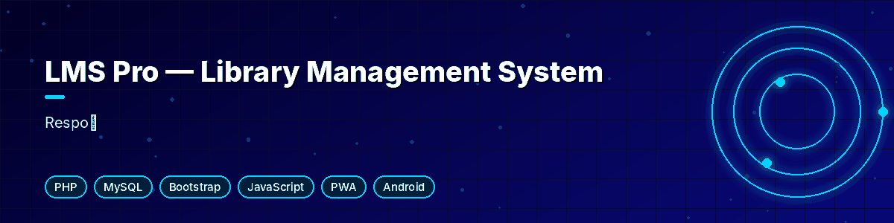
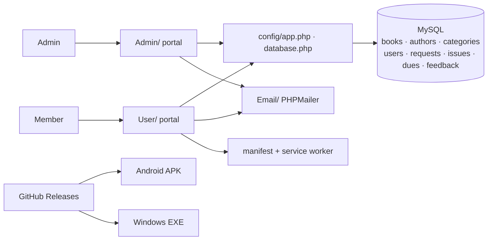

<div align="center">



# 📖 LMS Pro — Library Management System

### Responsive PHP + MySQL library system with admin and member portals, issue tracking and PWA support

     

[](LICENSE)    

[](https://codespaces.new/shiroonigami23-ui/lms-pro?quickstart=1) [](https://github.com/shiroonigami23-ui/lms-pro/archive/refs/heads/main.zip)

[**🚀 Live Demo**](https://sobran.lovestoblog.com/library/) · [**Overview**](#-overview) · [**Features**](#-features) · [**Architecture**](#-architecture) · [**Getting Started**](#-getting-started) · [**Roadmap**](#-roadmap)

</div>

---

## 📸 Preview

<p align="center"></p>

## 📖 Overview

**LMS Pro** is a complete library management system with two dedicated portals. **Admins** manage the catalogue (books,
authors, categories), approve or reject requests, issue and return books, monitor dues and overdue items, and read member
feedback. **Members** browse available books, request issues, track what they've borrowed and manage their profile.

It runs on any PHP + MySQL host (it's live on InfinityFree), uses PHPMailer for password-reset emails, ships PWA assets for
fast repeat visits, and is packaged as an **Android APK** and **Windows EXE** on the
[Releases](https://github.com/shiroonigami23-ui/lms-pro/releases) page.

### ✨ Highlights

- **Two portals** — Admin control centre + member self-service
- **Full circulation workflow** — request → approve → issue → return, with due/late monitoring
- **Analytics dashboard** with cards, quick actions, tabs and collapsible sections
- **Downloadable apps** — Android APK & Windows EXE wrappers
- **SLSA provenance** workflow for release artefacts

## 🧩 Features

| Feature | What it does |
|---|---|
| **Catalogue management** | Add / edit / delete books, authors and categories |
| **Member management** | Registered-user list, profile view, deletion |
| **Request approval** | Accept or reject member book requests |
| **Issue & return** | Issue books, view issued items and not-returned books |
| **Dues** | Edit and clear fines for late returns |
| **Feedback** | Members submit feedback; admins view and respond |
| **Authentication** | Separate admin/member login, change password, forgot-password via PHPMailer |
| **PWA** | Manifest + service worker + icons for installable experience |
| **Deploy check** | `LIVE_CHECK.php` returns `LMS_PRO_DEPLOY_OK` to confirm a correct upload |

## 🛠 Tech Stack

| Layer | Technology |
|---|---|
| Backend | PHP |
| Database | MySQL |
| UI | Bootstrap 4, JavaScript |
| Email | PHPMailer (SMTP) |
| Distribution | PWA, Android (TWA/Bubblewrap), Windows (Nativefier/Electron) |
| CI | GitHub Actions (SLSA generic provenance) |

## 🏗 Architecture

Two independent PHP portals share one MySQL database and a central config.



➡️ Full design notes, data flow and design decisions: **[docs/ARCHITECTURE.md](docs/ARCHITECTURE.md)**

## 📁 Project Structure

```text
lms-pro/
├── Admin/        # dashboard, books/authors/categories CRUD, approvals, issues, dues, feedback
├── User/         # member portal: browse, request, profile, feedback, PWA icons
├── Email/        # PHPMailer
├── config/       # app.php, database.php, app.local.example.php
├── database/     # library_management_patch.sql
├── LIVE_CHECK.php
└── index.php
```

## 🚀 Getting Started

### Prerequisites

- PHP 7.4+ and MySQL (XAMPP / WAMP / any shared host)

### 1. Get the code

Pick whichever method suits you:

| Method | Command |
|---|---|
| **HTTPS** | `git clone https://github.com/shiroonigami23-ui/lms-pro.git` |
| **SSH** | `git clone git@github.com:shiroonigami23-ui/lms-pro.git` |
| **GitHub CLI** | `gh repo clone shiroonigami23-ui/lms-pro` |
| **ZIP** | [Download](https://github.com/shiroonigami23-ui/lms-pro/archive/refs/heads/main.zip) and extract |
| **Codespaces** | [Open in browser](https://codespaces.new/shiroonigami23-ui/lms-pro?quickstart=1) — zero local setup, dev container preconfigured |

> 🔑 **Using SSH for the first time?** Generate a key with `ssh-keygen -t ed25519 -C "you@example.com"`, add the `.pub` contents at **GitHub → Settings → SSH and GPG keys**, then test with `ssh -T git@github.com`.

### 2. Install & set up

```bash
cd lms-pro
cp config/app.local.example.php config/app.local.php   # local overrides (DB credentials, base URL)
# import database/library_management_patch.sql into MySQL
```

### 3. Run

```bash
php -S localhost:8000          # then open http://localhost:8000/User/index.php
```
Visit `Admin/seed_admin.php` **once** to create the first admin, then delete that file.

## 🎮 Usage

**Deploying to InfinityFree (sub-folder)** — target `htdocs/library`:

1. Upload the project to `htdocs/library` keeping `Admin/`, `User/`, `bootstrap-4.4.1/`, `config/`, `index.php`, `.htaccess`.
2. Set DB values in `config/app.php` and import `database/library_management_patch.sql`.
3. Run `Admin/seed_admin.php` once, then remove it.
4. Verify: `https://<host>/library/LIVE_CHECK.php` should print `LMS_PRO_DEPLOY_OK`.

If another project shows up at `/library/User/index.php`, your hosted files are mixed — re-upload with the exact structure
above and clear the browser cache.

## 🗺 Roadmap

**v1.1 — Current release (done)**

- [x] Admin & member portals with full circulation workflow
- [x] Password reset by email
- [x] PWA assets, Android APK, Windows EXE
- [x] Live deployment with health check

**v1.2 — Smarter library**

- [ ] Automatic overdue reminders by email
- [ ] Barcode / QR scanning for issue and return
- [ ] Book cover + metadata auto-fill from ISBN (Open Library API)
- [ ] CSV import/export of catalogue

**v1.3 — Code quality**

- [ ] Security audit — prepared statements on every query and CSRF tokens on all forms
- [ ] Docker Compose dev environment
- [ ] PHPUnit tests and lint in CI

**v2.0 — Modernise**

- [ ] REST API + responsive SPA front-end
- [ ] Multi-branch libraries and role granularity (librarian, assistant)
- [ ] Reservation queue and recommendations

➡️ Detailed plan, milestones and long-term vision: **[docs/ROADMAP.md](docs/ROADMAP.md)**

## 🤝 Contributing

Contributions, issues and feature requests are welcome!

1. Fork the repository
2. Create a feature branch: `git checkout -b feature/amazing-feature`
3. Commit your changes: `git commit -m "feat: add amazing feature"`
4. Push the branch: `git push origin feature/amazing-feature`
5. Open a Pull Request against `main`

Check the [issues page](https://github.com/shiroonigami23-ui/lms-pro/issues) and the [roadmap](docs/ROADMAP.md) for ideas on where to help.

## 📜 Changelog

See [CHANGELOG.md](CHANGELOG.md) for the release history.

## 📄 License

Distributed under the **MIT** license. See [LICENSE](LICENSE) for details.

## 👤 Author

**Aryan Singh Chandel** (Shiro)

[](https://github.com/shiroonigami23-ui)

<div align="center">

⭐ **If you find this project useful, consider giving it a star!** ⭐

</div>
