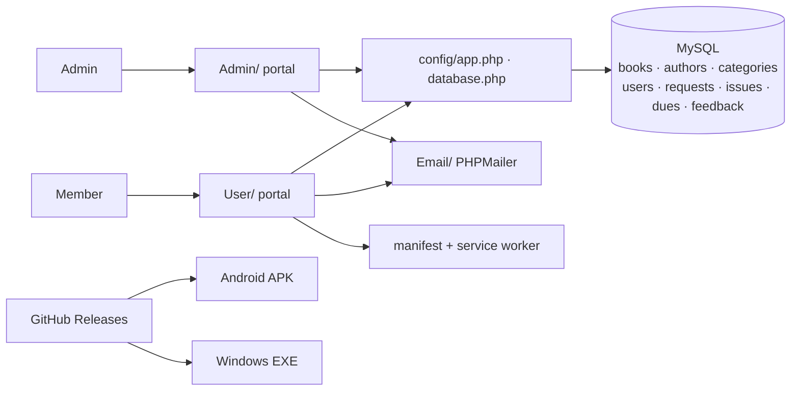

# 🏗 Architecture — LMS Pro — Library Management System

> Part of [lms-pro](https://github.com/shiroonigami23-ui/lms-pro). Back to the [README](../README.md).

## 1. System Overview

LMS Pro is a classic multi-page PHP application split into two portals. Each page includes a shared DB connection and
navbar, performs its query, and renders HTML with Bootstrap. Configuration is centralised in `config/` so the same code
runs locally and on hosting.

## 2. Components

| Component | Location | Responsibility |
|---|---|---|
| **Admin portal** | `Admin/` | Dashboard, catalogue CRUD, approvals, issues, dues, feedback, profile |
| **Member portal** | `User/` | Browse/request books, profile, feedback, PWA shell |
| **Config** | `config/` | App and database settings with local override |
| **Mail** | `Email/` | PHPMailer for password reset |
| **Schema** | `database/library_management_patch.sql` | Tables and optimisation patches |
| **Health check** | `LIVE_CHECK.php` | Deployment verification endpoint |

## 3. Data / Control Flow

1. A member requests a book from the available list.
2. The admin sees the request in *Approval* and accepts or rejects it.
3. Accepted requests become issues with a due date; overdue items appear in *Not returned* and accrue dues.
4. On return the issue closes; dues can be edited or cleared.

## 4. Key Design Decisions

| Decision | Rationale |
|---|---|
| Plain PHP pages | Works on free shared hosting without build tools |
| Separate Admin/User trees | Clear permission boundary and simpler navigation |
| Wrapper apps | APK/EXE reuse the hosted web app — one codebase to maintain |

## 5. Known Limitations

- No automated tests yet
- Single-library tenancy

---
*Last updated: 2026-11-13*
